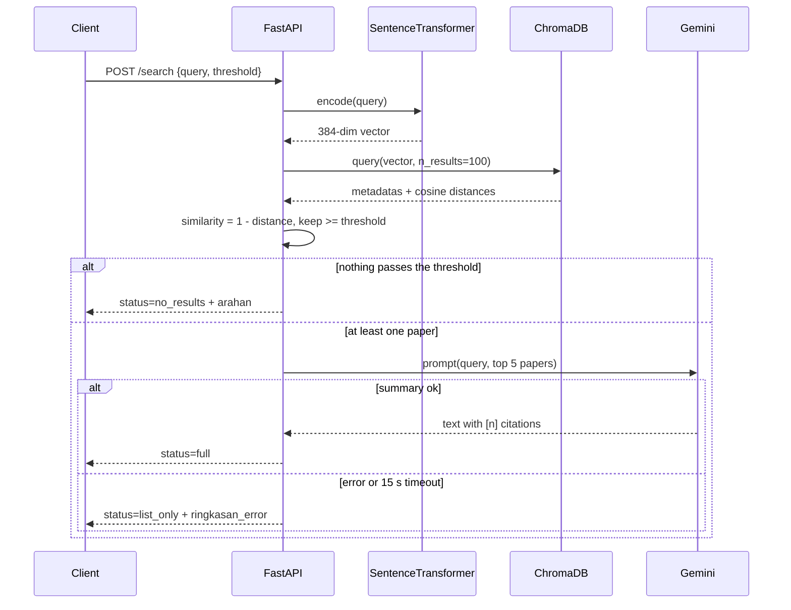

# Undip Research Semantic Search API

A small FastAPI service that answers free-text questions over ~1,000 harvested
Universitas Diponegoro eprints. It embeds the query, searches a local ChromaDB
collection by cosine similarity, returns the matching papers, and — when a
Gemini key is configured — adds an AI summary whose claims are cited against the
papers that were actually retrieved.

> **Status: prototype.** Built for a project demo, not a production deployment.
> See [Known limitations](#known-limitations) before relying on it.

## How it works



The service never fails a search because the LLM failed: the worst case is
`status=list_only`, which still returns the ranked papers.

## Quick start (local)

**Prerequisites**

- Python 3.11+
- The vector database in `./data/vector_db` — **the app refuses to start
  without it**. See [docs/DATA.md](docs/DATA.md) for how to build it.
- `GEMINI_API_KEY` and `GEMINI_MODEL` in `.env` (optional; without them the API
  still works and returns `status=list_only`).

```bash
cp .env.example .env                      # fill in both Gemini values
pip install -r requirements.txt
python ingest.py --all                    # only if data/vector_db/ is missing
uvicorn app:app --reload --port 8000 --env-file .env
```

`--env-file` is required locally: the app reads plain environment variables and
does not load `.env` by itself (Docker Compose injects the file for you). Without
it, searches still work but every response is `list_only`.

`DB_PATH` is relative, so always start uvicorn from this directory (`backend/`).

**Verify it works**

```bash
curl http://localhost:8000/health
# {"status":"ok","documents":1000,"llm_configured":true,"metric":"cosine"}
# documents = however many records your harvest produced

curl -X POST http://localhost:8000/search \
  -H "Content-Type: application/json" \
  -d '{"query": "faktor risiko stunting balita", "threshold": 0.53}'
```

Interactive docs are served at `http://localhost:8000/docs`; the machine-readable
schema is at `/openapi.json`.

## Quick start (Docker)

```bash
cp .env.example .env   # docker compose fails without this file
APP_UID=$(id -u) docker compose up -d --build --wait
```

`APP_UID` makes the container run as your own user, so it can write the
bind-mounted `./data/vector_db`; without it the app exits with
`attempt to write a readonly database`. On PowerShell:
`$env:APP_UID=1000; docker compose up -d --build --wait`. The command returns
only once the container is healthy.

The embedding model is cached in the `model_cache` volume, so restarts do not
re-download it. After changing `APP_UID`, run `docker compose down -v` once:
the old volume belongs to the previous UID.

For a demo, running uvicorn directly is simpler and has fewer moving parts.

## Configuration

| Variable | Required | Meaning |
|---|---|---|
| `GEMINI_API_KEY` | for AI summaries | Google Gemini API key |
| `GEMINI_MODEL` | for AI summaries | Model name, e.g. `gemini-2.5-flash`. A wrong name does not break startup — `/search` returns `list_only` with a message pointing at this variable |

Both are read from the process environment at request time. Locally, `.env` is
loaded at startup by `uvicorn --env-file .env`; Docker Compose loads it via
`env_file:`. Editing the file requires a restart either way. `.env` is
git-ignored; never commit it.

## API at a glance

| Endpoint | Purpose |
|---|---|
| `POST /search` | Semantic search over the indexed papers, with optional AI summary |
| `GET /health` | Liveness plus `documents`, `llm_configured`, `metric` |

Full contract — every field, every status, every error, and the
distance-vs-similarity rule that trips everyone up — is in
[docs/API.md](docs/API.md).

The frontend still sends the older field name `max_threshold`. It is accepted as
an alias for `threshold` (same **minimum similarity** scale) and mirrored in the
response, so both names always agree.

## Why the default is 0.53

`threshold` is a **minimum similarity**, not a distance: higher means stricter.
It is a relevance gate, not a knob for "make sure something comes back". An
empty result is a valid answer.

The default (`0.53`, `THRESHOLD_DEFAULT` in `app.py`) was measured on the 1,000-record
collection, not guessed. The method: score a set of phrasal queries that should
match and a set of off-topic queries that should not, then take the midpoint
**only if the two bands separate**. On the shipped corpus they do.

Measured on the 1,000-record collection with the real model:

| Query shape | Best score |
|---|---|
| full phrase (`pengaruh media sosial terhadap perilaku remaja`) | 0.73 |
| full phrase (`analisis kualitas air sungai`) | 0.66 |
| shorter phrase (`energi terbarukan`) | 0.58 |
| one word (`stunting`) | 0.47 |
| off-topic (`resep rendang padang`) | 0.46 |

Noise tops out at 0.46 and relevant phrases start at 0.58, so `0.53` sits in the
gap. Single-word queries fall below it on purpose: they are too vague to be
called relevant. Ask for what you want in a phrase instead of lowering the bar —
and accept an empty list when the corpus genuinely has nothing.

If you change the corpus, the model, or the ingestion code, re-measure before
trusting the constant: run `python ingest.py --query "<phrase>"` for a few
relevant and off-topic phrases and compare the reported similarities. If the
bands overlap, fix retrieval rather than inventing a threshold.

## Project structure

```
app.py                 the entire service: lifespan, schemas, /search, /health, Gemini
ingest.py                  the only ingestion path: OAI-PMH -> JSON -> embeddings -> Chroma
tests/test_app.py      API tests; fake model and fake collection, no downloads
tests/test_ingest.py       ingestion tests; fake records, model, and Chroma client
docs/API.md                API reference
docs/DATA.md               ingestion pipeline and metadata contract
docs/DEMO.md               pre-meeting checklist and demo runbook
Dockerfile                 CPU-only image, non-root user
docker-compose.yml         single service + model cache volume
```

## Troubleshooting

| Symptom | Cause | Fix |
|---|---|---|
| `RuntimeError: ChromaDB collection 'undip_research_search' was not found` | Database missing, or uvicorn started from the wrong directory | Build the DB ([docs/DATA.md](docs/DATA.md)) and run from `backend/` |
| Startup hangs at "Waiting for application startup" with no further output | The repo sits on a network path (`\\wsl.localhost\...`, a share); SQLite blocks on it | Run uvicorn inside WSL, or copy the repo and the DB to a local disk |
| Startup takes minutes | First-time embedding-model download (~470 MB) | Wait once; the HuggingFace cache (or `model_cache` volume) is reused |
| `/health` shows `"documents": 0` | Empty collection | Run `python ingest.py --all` |
| `docker compose up` fails with `attempt to write a readonly database` | Bind-mounted DB owned by your UID; the image runs as a different UID | Build with `APP_UID=$(id -u) docker compose up -d --build`, or `chmod -R a+rwX data/vector_db` as a stopgap |
| `/health` shows `"metric": null` or something other than `cosine` | Collection built without `hnsw:space=cosine` | Rebuild the collection with `python ingest.py --index`; scores are meaningless otherwise |
| `status=list_only`, message "belum dikonfigurasi" | Gemini variables empty — often uvicorn started without `--env-file .env` | Set them, restart with `--env-file .env` |
| `status=list_only`, message about quota | Gemini 429 / rate limit | Wait, or raise the quota |
| `status=list_only`, message "Model LLM '...' tidak ditemukan" | Wrong `GEMINI_MODEL` | Use a currently available model name |
| `status=list_only`, message "tidak merespons tepat waktu" | Gemini was slower than 15 s | Retry; if it happens often, check quota and network |
| `status=no_results` on a one-word query | Short queries score below the default (0.47 vs 0.58–0.73 for phrases) | Ask in a phrase with more context; do not lower the threshold just to fill the list |
| `status=no_results` every time | Threshold too strict, or the corpus genuinely has no match | Score a phrase with `python ingest.py --query "<phrase>"`; if nothing is close, the retrieval is the problem, not the threshold |
| `status=no_results`, `arahan` says "Belum ada dokumen" | Collection is empty | Run `python ingest.py --all` |
| `422 Unprocessable Content` | Empty/whitespace `query`, or `threshold` outside 0.1–0.9 | Fix the request body |
| Browser CORS error | Should not happen (`allow_origins=["*"]`) | Confirm the response carries `access-control-allow-origin: *` |

## Known limitations

- **Sample, not corpus.** `ingest.py` stops at the first 1,000 valid records in
  OAI order (5,035 records scanned on the live feed), so the indexed set is an
  early-page sample rather than a random one.
- **Truncated abstracts.** The embedding model truncates at 128 tokens, so
  stored vectors effectively represent the title plus the opening of the
  abstract.
- **Top 100 only.** The service always fetches 100 candidates and filters them in
  Python; there is no pagination or `offset`.
- **Threshold measured on one sample.** `0.53` separates relevant from off-topic
  on this 1,000-record sample; re-measure on a different corpus. See
  [Why the default is 0.53](#why-the-default-is-053).
- **No authentication or rate limiting.** Anyone who can reach the port can spend
  Gemini quota.
- **No incremental ingestion.** Re-running `ingest.py --index` deletes and
  recreates the collection.
- **One process, one worker.** The model is loaded once per process.
- **No CI, linter, or lockfile.** Dependencies are range-pinned only.

## Data source and credits

Paper metadata comes from the Universitas Diponegoro eprints2 repository via
OAI-PMH (`https://eprints2.undip.ac.id/cgi/oai2`, `metadataPrefix=oai_dc`). Embeddings
use
[`sentence-transformers/paraphrase-multilingual-MiniLM-L12-v2`](https://huggingface.co/sentence-transformers/paraphrase-multilingual-MiniLM-L12-v2).
Summaries are generated by Google Gemini.
