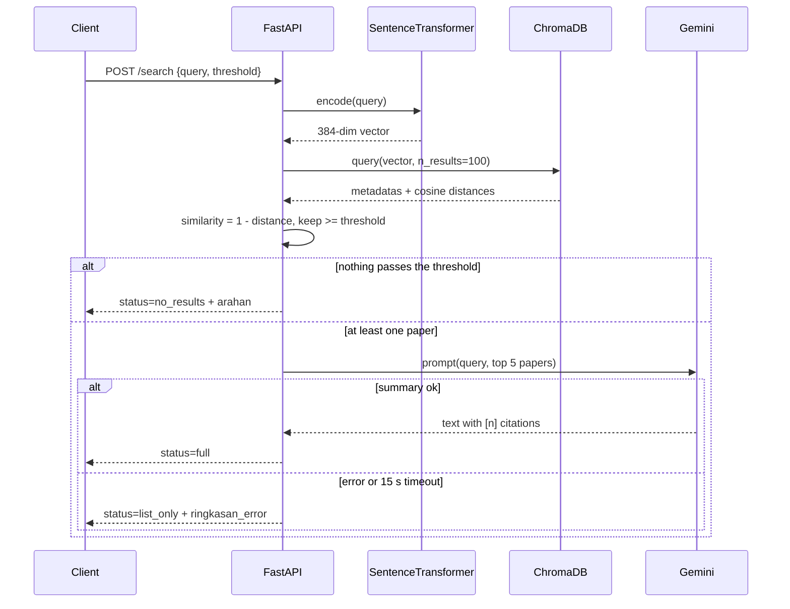

# Undip Research Semantic Search API

A small FastAPI service that answers free-text questions over ~1,000 harvested
Universitas Diponegoro eprints. It embeds the query, searches a local ChromaDB
collection by cosine similarity, returns the matching papers, and — when a
Gemini key is configured — adds an AI summary whose claims are cited against the
papers that were actually retrieved.

> **Status: prototype.** Built for a project demo, not a production deployment.
> See [Known limitations](#known-limitations) before relying on it.

## How it works



The service never fails a search because the LLM failed: the worst case is
`status=list_only`, which still returns the ranked papers.

## Quick start (local)

**Prerequisites**

- Python 3.11+
- The vector database in `./data/vector_db` — **the app refuses to start
  without it**. See [docs/DATA.md](docs/DATA.md) for how to build it.
- `GEMINI_API_KEY` and `GEMINI_MODEL` in `.env` (optional; without them the API
  still works and returns `status=list_only`).

```bash
cp .env.example .env                      # fill in both Gemini values
pip install -r requirements.txt
python -m ingestion.ingest --all                    # only if data/vector_db/ is missing
uvicorn service.app:app --reload --port 8000 --env-file .env
```

`--env-file` is required locally: the app reads plain environment variables and
does not load `.env` by itself (Docker Compose injects the file for you). Without
it, searches still work but every response is `list_only`.

`CHROMA_DB_PATH` is relative, so always start uvicorn from this directory
(`backend/`).

**Verify it works**

```bash
curl http://localhost:8000/health
# {"status":"ok","documents":1000,"llm_configured":true,"metric":"cosine"}
# documents = however many records your harvest produced

curl -X POST http://localhost:8000/search \
  -H "Content-Type: application/json" \
  -d '{"query": "faktor risiko stunting balita", "threshold": 0.60}'
```

Interactive docs are served at `http://localhost:8000/docs`; the machine-readable
schema is at `/openapi.json`.

## Quick start (Docker)

```bash
cp .env.example .env   # docker compose fails without this file
APP_UID=$(id -u) docker compose -f docker/docker-compose.yml --env-file .env up -d --build --wait
```

This builds and serves `service/app.py` on <http://localhost:8000>, and returns only once
the container is healthy. Override the published port with `API_PORT` (Compose
maps `${API_PORT:-8000}:8000`) and the first-start grace period with
`HEALTH_START_PERIOD` (default `120s`).

`--env-file .env` is not optional. `-f docker/docker-compose.yml` makes `docker/`
the project directory, so Compose looks for `docker/.env` when it substitutes
`${APP_UID}`, `${API_PORT}` and `${HEALTH_START_PERIOD}`. That file does not
exist, and every one of those would fall back to its default *silently* — the
container still receives the value through `env_file: ../.env`, which is why
`docker inspect` looks correct while `start_period` stays at `120s`. Omitting the
flag is how a slow first model load turns into a spurious `unhealthy`.

The Compose project is `aisen`, so the container is `aisen-api`, the network
`aisen_default`, and the model cache volume `aisen_model_cache`. Those names are
deliberately shared with `frontend/docker-compose.yml`, which proxies `/api` to
`http://aisen-api:8000` — so the UI reaches this container by name, without CORS
and without publishing the API port to the browser's machine.

`APP_UID` makes the container run as your own user, so it can write the
bind-mounted `./data/vector_db`. On PowerShell:
`$env:APP_UID=1000; docker compose -f docker/docker-compose.yml --env-file .env up -d --build --wait`.

If the UID does not match, `docker-entrypoint.sh` stops the container before
ChromaDB is opened and prints the owner UID, the container UID, and the exact
command to fix it — instead of the raw `attempt to write a readonly database`
traceback. The default is `10001`, so a plain `docker compose -f
docker/docker-compose.yml up` always starts the guard path rather than depending
on the host UID.

The collection has to exist before the server starts: build it on the host with
`python -m ingestion.ingest --all`, or use the Docker-only path below.

The embedding model is cached in the `model_cache` volume, prefixed with the
Compose project name (`aisen_model_cache`). Renaming the project starts from an
empty cache and redownloads the ~470 MB model once. Changing `APP_UID` leaves
that volume owned by the previous user; either hand it to the new one, which
keeps the download —

```bash
docker compose -f docker/docker-compose.yml --env-file .env down
docker run --rm -v aisen_model_cache:/model-cache busybox chown -R "$(id -u):$(id -g)" /model-cache
```

— or delete it with `docker volume rm aisen_model_cache` (equivalently
`docker compose -f docker/docker-compose.yml --env-file .env down -v`) and pay the download again.

### Ingesting without installing Python on the host

The serving image does not contain `ingestion/ingest.py`. A second Compose service,
`tools`, builds the same Dockerfile with `INGEST=1` — so the heavy torch layer is
reused rather than downloaded twice — and runs the script with the repository
mounted:

```bash
docker compose -f docker/docker-compose.yml --env-file .env --profile tools run --rm tools --all
docker compose -f docker/docker-compose.yml --env-file .env --profile tools run --rm tools --query "analisis kualitas air sungai"
```

`--profile tools` is needed because the service is hidden by default, so a plain
`docker compose -f docker/docker-compose.yml --env-file .env up` still starts only the API. This
is the Docker-only path: no `pip install`, and `--query` uses the same
`rank_results()` as `POST /search`, so its scores match the API exactly.

For a demo, running uvicorn directly is simpler and has fewer moving parts.

## Configuration

Everything is optional: with an empty `.env` the service runs on the defaults
below, which are the values that were measured and shipped. Set only what you
need. `.env.example` is the full inventory with the reasoning for each value.

| Variable | Default | Meaning |
|---|---|---|
| `GEMINI_API_KEY` | — | Google Gemini API key. Without it summaries are disabled |
| `GEMINI_MODEL` | — | Model name, e.g. `gemini-2.5-flash`. A wrong name does not break startup — `/search` returns `list_only` pointing at this variable |
| `EMBEDDING_MODEL` | `sentence-transformers/paraphrase-multilingual-MiniLM-L12-v2` | Must match the model the collection was built with. A mismatch is logged at startup |
| `CHROMA_DB_PATH` | `./data/vector_db` | ChromaDB directory, relative to `backend/` |
| `CHROMA_COLLECTION` | `undip_research_search` | Collection name |
| `SEARCH_N_RESULTS` | `100` | Candidates fetched per query; also the maximum result count |
| `THRESHOLD_MIN` / `THRESHOLD_MAX` | `0.1` / `0.9` | Accepted range for the request's `threshold` |
| `THRESHOLD_DEFAULT` | `0.60` | Applied when a request omits the threshold |
| `SUMMARY_TOP_K` | `5` | Results handed to the LLM; must be ≤ `SEARCH_N_RESULTS` |
| `LLM_TIMEOUT_SECONDS` | `15` | Gemini budget before falling back to `list_only` |
| `CORS_ALLOW_ORIGINS` | `*` | Comma-separated allowed origins |
| `LOG_LEVEL` | `INFO` | `DEBUG`, `INFO`, `WARNING`, `ERROR`, `CRITICAL` |
| `LOG_FORMAT` | `text` | `text` for `[time] [logger] [LEVEL] message key=value`; `json` for one JSON object per line when a collector reads it |
| `LOG_FILE` | — | Also append logs to this file, e.g. `logs/aisen.log` |
| `OAI_ENDPOINT` | `https://eprints2.undip.ac.id/cgi/oai2` | Harvest source |
| `INGEST_TARGET` | `1000` | Valid records to harvest |
| `INGEST_JSON_PATH` | `data/documents.json` | Harvest output |
| `INSERT_BATCH_SIZE` | `1000` | Records per ChromaDB insert (cap ≈ 5,461) |
| `EMBED_BATCH_SIZE` | `64` | Documents per embedding batch |
| `PROGRESS_EVERY` | `250` | Log a harvest progress line every N valid records |
| `EMBED_CHUNK_SIZE` | `5000` | Encode and log in chunks of N documents |
| `MIN_DESCRIPTION_CHARS` | `50` | Harvest filter: skip shorter abstracts |
| `WATCH_INTERVAL_SECONDS` | `30` | `watch` service poll interval for `/ready` |
| `WATCH_TIMEOUT_SECONDS` | `5` | `watch` service request timeout |
| `ALERT_WEBHOOK_URL` | — | Optional webhook the `watch` service POSTs state changes to |

Ingestion flags (`--target`, `--endpoint`, `--json`, `--db`, `--progress-every`,
`--embed-chunk-size`) still override the corresponding variables for a single
run.

Invalid combinations stop the process at import time with a message naming the
offending variable — for example `THRESHOLD_DEFAULT` outside `MIN..MAX`,
`SUMMARY_TOP_K > SEARCH_N_RESULTS`, or an unknown `LOG_LEVEL`. Nothing starts
half-configured.

Variables are read once at import. Locally `.env` is loaded by
`uvicorn --env-file .env`; Docker Compose loads it via `env_file:`. Editing the
file requires a restart either way. `.env` is git-ignored; never commit it.

## API at a glance

| Endpoint | Purpose |
|---|---|
| `POST /search` | Semantic search over the indexed papers, with optional AI summary |
| `GET /health` | Liveness only: process is up, version and uptime. No database work |
| `GET /ready` | Readiness: collection open, non-empty, cosine, model matched; `503` with `problems` otherwise |

Full contract — every field, every status, every error, and the
distance-vs-similarity rule that trips everyone up — is in
[docs/API.md](docs/API.md).

The frontend still sends the older field name `max_threshold`. It is accepted as
an alias for `threshold` (same **minimum similarity** scale) and mirrored in the
response, so both names always agree.

## Why the default is 0.60

`threshold` is a **minimum similarity**, not a distance: higher means stricter.
It is a relevance gate, not a knob for "make sure something comes back". An
empty result is a valid answer.

The default (`0.60`, `THRESHOLD_DEFAULT` in `common/config.py`) was measured on the
**full 47,913-record collection**, not guessed and not inherited from the old
1,000-record sample. The method: score phrasal queries that should match and
off-topic queries that should not, then place the threshold in the gap **only if
the two bands separate**.

Measured on all 47,913 records with the real model:

| Query | Best score | 100th score |
|---|---|---|
| `coral reef ecosystem` | 0.8395 | 0.5503 |
| `analisis kualitas air sungai` | 0.7867 | 0.6266 |
| `faktor risiko stunting pada balita` | 0.7396 | 0.6035 |
| `harga bitcoin hari ini` (present in corpus: crypto-law papers) | 0.6945 | — |
| `cara membuat kue ulang tahun` (off-topic) | 0.5592 | — |
| `resep rendang padang` (off-topic) | 0.5379 | — |
| `jadwal sepak bola liga inggris` (off-topic) | 0.4924 | — |
| one word `stunting` | 0.5265 | — |

Off-topic noise tops out at **0.559**, and all three relevant phrases clear
`0.60` with a full 100 results. `0.60` sits in that gap.

Two things this table makes explicit:

- **0.53 no longer works on the full corpus.** It let food-adjacent noise through
  — `resep rendang padang` returned a *mochi* thesis at 0.5379 — while a
  legitimate one-word query (`stunting`, 0.5265) fell below it. The old number
  came from a 1,000-doc sample and did not survive the corpus growing 48×.
- **More documents raises both bands.** Relevant phrases rose from 0.58–0.73 to
  0.74–0.84 because a larger corpus contains closer lexical matches; noise rose
  from ≤0.46 to ≤0.559 for the same reason. Do not assume the number is portable.

Single-word queries still fall below the gate on purpose: one word carries too
little context to be called relevant. Ask for what you want in a phrase instead
of lowering the bar — and accept an empty list when the corpus genuinely has
nothing.

If you change the corpus, the model, or the ingestion code, **re-measure before
trusting the constant**: run `python -m ingestion.ingest --query "<phrase>" --min-similarity 0`
for a few relevant and off-topic phrases and compare the reported similarities.
If the bands overlap, fix retrieval rather than inventing a threshold.

## Observability

Long-running work announces itself, so a silent process is never mistaken for a
hang:

- **Ingestion** logs a harvest line every `PROGRESS_EVERY` records and an encode
  line per `EMBED_CHUNK_SIZE` documents, including rate and ETA
  (`embedding | done=25000/47915, pct=52%, rate=19.3/s, eta=19m`). Each stage is
  timed, and the run ends with `ingest complete | took=41m12s, records=47915` or
  `INGEST FAILED | stage=index, after=2m03s, error="TypeError: …"`.
- **Log shape.** Terminal lines are a frame, a phrase, then the data:

  ```
  [07:44:54.123] [INFO] [ingest]: harvest complete | valid=47945, scanned=55575
  [07:44:54.124] [WARNING] [ingest]: collection is empty
  [07:44:54.125] [CRITICAL] [ingest]: boom
  ```

  Three tight cells (`[INFO]`, never `[ INFO ]`), one space between them, `: `
  before the phrase, ` | ` before the data, `, ` between pairs. Nothing is padded
  to a column: the `:` is the anchor the eye lands on, and the phrase starts a few
  characters later on a `[CRITICAL]` line than on an `[INFO]` one — that is the
  trade for a shorter, simpler line. Punctuation is classified by where it sits:
  the frame and the three dividers are structure; `key=value` is data; inside a
  value everything is passed through byte-for-byte — a `:` in `TypeError: x`, a
  `{}` in a metadata repr and a `%` in `pct=52%` are content. A value is quoted
  only when it holds a space, a quote or a newline, which keeps a multi-line error
  message on one line and keeps an unquoted ` | ` unambiguous. Third-party
  libraries log through the same handler; their DEBUG chatter is indented so it
  reads as background. Use `LOG_FORMAT=json` when a collector is reading, not a
  person.
- **One writer.** `ingestion/ingest.py` takes an `flock` on `data/.ingest.lock`; a second
  run exits immediately with `another ingest is already running (pid …)`
  instead of interleaving a delete with the other run's inserts.
- **Persisted outcome.** Every run writes `data/last_ingest.json` (status, stage,
  timings, counts, error). `/ready` surfaces it, so "did the last ingest work?"
  does not depend on scrollback from a `--rm` container.
- **Request correlation.** Every request gets an `X-Request-ID` (accepted from
  the caller or generated), echoed in the response and in each log line, and
  included in the JSON body of an unexpected `500`.
- **Configuration dump.** Startup logs the model, collection, threshold, log
  level, and LLM budget once, so a wrong `.env` is visible without guessing.
- **`watch` service.** Sits next to `aisen-api`, polls `/ready` every 30 s, and
  logs only state changes. Set `ALERT_WEBHOOK_URL` to also receive a Discord or
  generic webhook message when the API goes down or recovers.
- **Bounded logs.** Both services use the `json-file` driver with `max-size: 10m`
  and `max-file: 3`, so logs cannot fill the disk.

`GET /health` is deliberately database-free (it backs the Compose healthcheck,
so a broken index never causes a restart loop). Use `GET /ready` for the facts
that decide whether searches can work.

## Sizing

The defaults are tuned for one modest machine. To move to another tier, change
only the six knobs below; everything else is either fixed or ingest-only.

Two facts invert the usual intuition, so start there:

- **`SEARCH_N_RESULTS` is the main per-query cost, and it is nearly free to cut.**
  Chroma fetches that many candidates and Python filters them by `threshold`. The
  threshold already decides relevance, so a smaller candidate pool changes *what
  is shown* far less than it changes *how much work each request does*.
- **`EMBED_*`, `INSERT_BATCH_SIZE` and `PROGRESS_EVERY` are ingest-only.** They
  change the memory peak and log volume of `ingestion/ingest.py` and have zero
  effect on the serving container. Lowering them does not make the API cheaper.

### Fixed costs — no setting reduces these

| Cost | Value |
| --- | --- |
| Embedding model | `paraphrase-multilingual-MiniLM-L12-v2`, ~118M params, 384 dims, CPU torch |
| Vectors | 47,913 × 384 × 4 B ≈ **70 MB** raw float32 |
| Chroma on disk | budget **2–3×** raw for the HNSW index (~150–210 MB) |
| Model load on boot | the longest startup step on CPU; `HEALTH_START_PERIOD` must exceed it |

### The six knobs

| Knob | What it trades |
| --- | --- |
| `SEARCH_N_RESULTS` | per-query work and result cap — the big serving lever |
| `SUMMARY_TOP_K` | prompt size, so Gemini latency and token cost (must be ≤ `SEARCH_N_RESULTS`) |
| `LLM_TIMEOUT_SECONDS` | how long a slow LLM is tolerated before `list_only` |
| `EMBED_BATCH_SIZE` | ingest memory peak; lower on a small-RAM machine |
| `EMBED_CHUNK_SIZE` | ingest memory held per chunk, and encode-line cadence |
| `HEALTH_START_PERIOD` | Compose start grace; too low turns slow model load into a restart loop |

### Tiers

**Low** — 2 vCPU, 2 GB RAM, no GPU. Startup is the risk here, not throughput.

```bash
SEARCH_N_RESULTS=25
SUMMARY_TOP_K=3
LLM_TIMEOUT_SECONDS=20
EMBED_BATCH_SIZE=16
EMBED_CHUNK_SIZE=1000
INSERT_BATCH_SIZE=500
PROGRESS_EVERY=100
LOG_LEVEL=WARNING
LOG_FILE=logs/aisen.log
HEALTH_START_PERIOD=300s
```

**Medium** — 4 vCPU, 8 GB RAM, no GPU.

```bash
SEARCH_N_RESULTS=50
SUMMARY_TOP_K=5
LLM_TIMEOUT_SECONDS=15
EMBED_BATCH_SIZE=32
EMBED_CHUNK_SIZE=2000
INSERT_BATCH_SIZE=1000
PROGRESS_EVERY=250
LOG_LEVEL=INFO
LOG_FILE=logs/aisen.log
HEALTH_START_PERIOD=180s
```

**High** — 8+ vCPU, 16 GB RAM, GPU optional.

```bash
SEARCH_N_RESULTS=100
SUMMARY_TOP_K=8
LLM_TIMEOUT_SECONDS=15
EMBED_BATCH_SIZE=128
EMBED_CHUNK_SIZE=10000
INSERT_BATCH_SIZE=2000
PROGRESS_EVERY=500
LOG_LEVEL=INFO
LOG_FILE=logs/aisen.log
HEALTH_START_PERIOD=120s
```

### Invariants — `Settings.validate()` rejects these at startup

- `THRESHOLD_MIN < THRESHOLD_DEFAULT < THRESHOLD_MAX`
- `SUMMARY_TOP_K <= SEARCH_N_RESULTS`
- `INSERT_BATCH_SIZE <= 5461` (ChromaDB's batch cap)

`THRESHOLD_DEFAULT` is **not** a sizing knob. It is measured on the full corpus
(relevant 0.74–0.84, noise ≤ 0.559); lowering it on a small machine to "get more
results" is the 0.53 bug that leaked food-adjacent noise. A smaller
`SEARCH_N_RESULTS` can legitimately return fewer results — that is a valid
answer, not a reason to loosen the threshold.

## Project structure

Modules are grouped by role. Imports are top-level (`from common.config import
SETTINGS`), so every command runs from `backend/`.

```
common/
  config.py                every configurable value, read once from the environment
  log.py                   text/json/file logging shared by the API and the ingester
service/
  app.py                   the service: lifespan, schemas, /search, /health, /ready, Gemini
  watch.py                 /ready poller that logs state changes and optionally alerts
ingestion/
  ingest.py                the only ingestion path: OAI-PMH -> JSON -> embeddings -> Chroma
docker/
  Dockerfile               CPU-only image, non-root user, INGEST arg for the tools image
  docker-compose.yml       aisen-api, `watch` service, `tools` ingest profile, model cache
  docker-entrypoint.sh     UID/writability guard, checked before the server starts
  .dockerignore            keeps .env, data/, and caches out of the build context
data/                      generated and git-ignored, except .gitkeep which keeps
                           the directory itself tracked (Docker would create a
                           missing bind-mount source as root)
tests/                     test_app.py, test_ingest.py, test_settings.py
                           fake model and fake collection, so no download is needed
docs/                      API.md, DATA.md, DEMO.md
pyproject.toml             pytest configuration (pythonpath, testpaths). No
                           [build-system] on purpose: nothing is packaged or
                           installed — the image binds the sources — so an
                           install step would misrepresent the deployment
.env.example               full configuration inventory
```

Modules are grouped by role, and the grouping carries one rule: `service/`
never imports `ingestion/`. The API does not need to harvest, and the ingester
reuses `service.app.rank_results` rather than the reverse, so the dependency
only ever points one way.

Compose lives in `docker/`, so its paths are relative to that directory and the
file has to be named when running a command:

```bash
docker compose -f docker/docker-compose.yml --env-file .env up -d --build --wait
docker compose -f docker/docker-compose.yml --env-file .env --profile tools run --rm tools --all
```

## Troubleshooting

| Symptom | Cause | Fix |
|---|---|---|
| `RuntimeError: ChromaDB collection 'undip_research_search' was not found` | Database missing, or uvicorn started from the wrong directory | Build the DB ([docs/DATA.md](docs/DATA.md)) and run from `backend/` |
| Startup hangs at "Waiting for application startup" with no further output | The repo sits on a network path (`\\wsl.localhost\...`, a share); SQLite blocks on it | Run uvicorn inside WSL, or copy the repo and the DB to a local disk |
| Startup takes minutes | First-time embedding-model download (~470 MB) | Wait once; the HuggingFace cache (or `model_cache` volume) is reused |
| `/ready` shows `"documents": 0` | Empty collection | Run `python -m ingestion.ingest --all` |
| `docker compose -f docker/docker-compose.yml --env-file .env up` logs `the data directory is not writable by this container` | Bind-mounted `./data` owned by a UID other than `APP_UID` (usually root, from Docker creating it) | The container prints the fix. On a fresh clone this should not happen: `data/.gitkeep` keeps the directory in git, owned by you. If it was deleted, `mkdir -p data && sudo chown -R "$(id -u):$(id -g)" data` |
| `/ready` shows `"metric": null` or something other than `cosine` | Collection built without `hnsw:space=cosine` | Rebuild the collection with `python -m ingestion.ingest --index`; scores are meaningless otherwise |
| `/ready` lists `last ingest failed: …` | The most recent `ingestion/ingest.py` run aborted | Fix the reported cause, then read `data/last_ingest.json` for counts and timings |
| `status=list_only`, message "belum dikonfigurasi" | Gemini variables empty — often uvicorn started without `--env-file .env` | Set them, restart with `--env-file .env` |
| `status=list_only`, message about quota | Gemini 429 / rate limit | Wait, or raise the quota |
| `status=list_only`, message "Model LLM '...' tidak ditemukan" | Wrong `GEMINI_MODEL` | Use a currently available model name |
| `status=list_only`, message "tidak merespons tepat waktu" | Gemini was slower than 15 s | Retry; if it happens often, check quota and network |
| `status=no_results` on a one-word query | Short queries score much lower than phrases (one word `stunting` 0.53 vs 0.74–0.84 for phrases) | Ask in a phrase with more context; do not lower the threshold just to fill the list |
| `status=no_results` every time | Threshold too strict, or the corpus genuinely has no match | Score a phrase with `python -m ingestion.ingest --query "<phrase>"`; if nothing is close, the retrieval is the problem, not the threshold |
| `status=no_results`, `arahan` says "Belum ada dokumen" | Collection is empty | Run `python -m ingestion.ingest --all` |
| `docker compose -f docker/docker-compose.yml --env-file .env logs -f` shows an old traceback after a successful restart | `-f` replays the whole history, including the previous failed attempt | Use `docker compose -f docker/docker-compose.yml --env-file .env logs --tail 40 aisen-api`, and confirm with `docker inspect aisen-api --format '{{.State.Health.Status}}'` |
| `422 Unprocessable Content` | Empty/whitespace `query`, or `threshold` outside 0.1–0.9 | Fix the request body |
| Browser CORS error | Should not happen (`allow_origins=["*"]`) | Confirm the response carries `access-control-allow-origin: *` |

## Known limitations

- **Sample, not whole corpus, by default.** `INGEST_TARGET` defaults to 1,000
  records in OAI order, so a default ingest is an early-page sample rather than a
  random one. The measured 0.60 assumes the full ~47,913-record corpus; a small
  ingest shifts both bands down and needs re-measuring.
- **Truncated abstracts.** The embedding model truncates at 128 tokens, so
  stored vectors effectively represent the title plus the opening of the
  abstract.
- **Top 100 only.** The service always fetches 100 candidates and filters them in
  Python; there is no pagination or `offset`.
- **Threshold measured on one corpus.** `0.60` separates relevant from off-topic
  on the full 47,913-record collection; re-measure on a different corpus. See
  [Why the default is 0.60](#why-the-default-is-060).
- **No authentication or rate limiting.** Anyone who can reach the port can spend
  Gemini quota.
- **No incremental ingestion.** Re-running `python -m ingestion.ingest --index` deletes and
  recreates the collection.
- **One process, one worker.** The model is loaded once per process.
- **No CI, linter, or lockfile.** Dependencies are range-pinned only.

## Data source and credits

Paper metadata comes from the Universitas Diponegoro eprints2 repository via
OAI-PMH (`https://eprints2.undip.ac.id/cgi/oai2`, `metadataPrefix=oai_dc`). Embeddings
use
[`sentence-transformers/paraphrase-multilingual-MiniLM-L12-v2`](https://huggingface.co/sentence-transformers/paraphrase-multilingual-MiniLM-L12-v2).
Summaries are generated by Google Gemini.
